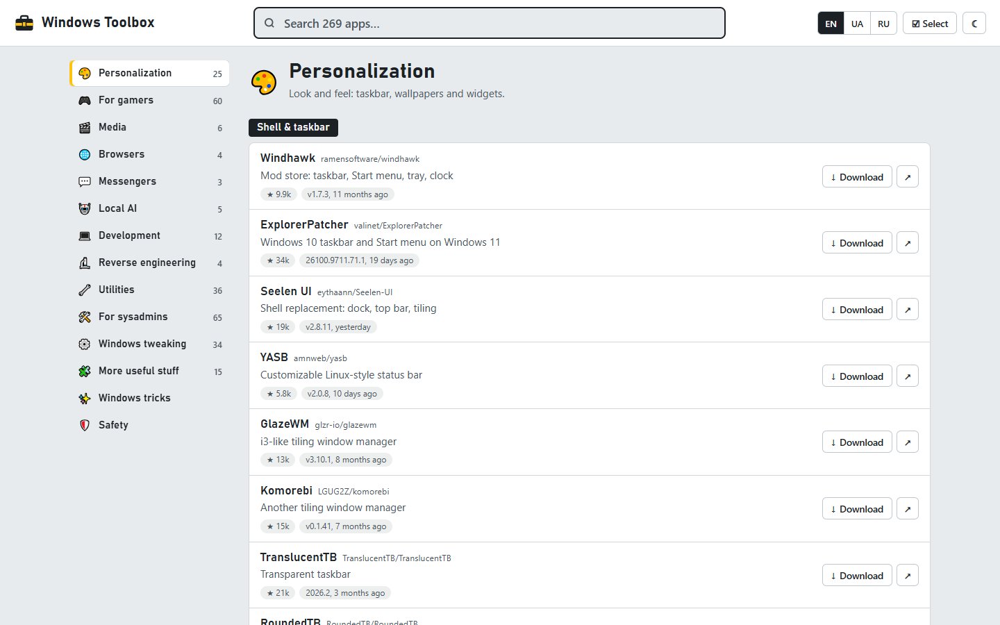
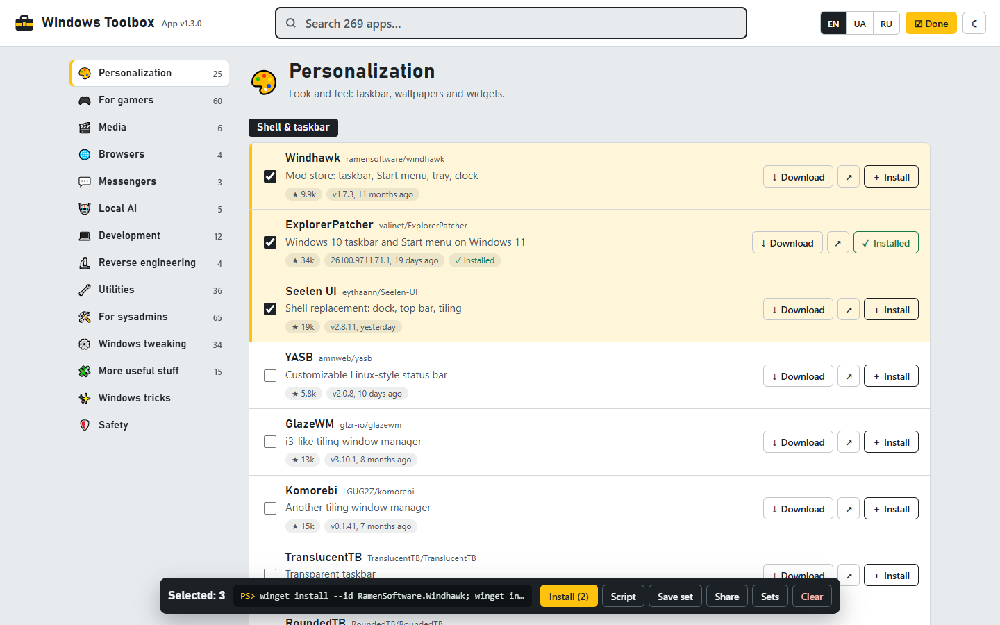
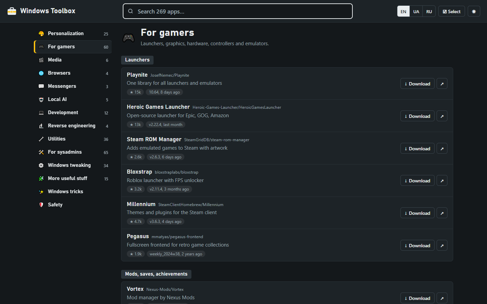

# Windows Toolbox

**English** | [Русский](README.ru.md) | [Українська](README.uk.md)

[](https://github.com/barnibeats/windows-toolbox/releases/latest)
[](https://github.com/barnibeats/windows-toolbox/actions/workflows/pages.yml)
[](https://github.com/barnibeats/windows-toolbox/actions/workflows/ci.yml)
[](LICENSE)

A catalog of free open-source apps for Windows, plus a small portable app that downloads or installs them in one click. About 270 apps in 14 sections: personalization, games, media, browsers, development, system administration, tweaks and more. English, Ukrainian and Russian.

**[Download WindowsToolbox.exe](https://github.com/barnibeats/windows-toolbox/releases/latest/download/WindowsToolbox.exe)**: portable, no installer. It needs the WebView2 Runtime, which is built into Windows 11. On Windows 10, [get it from Microsoft](https://go.microsoft.com/fwlink/p/?LinkId=2124703).

Prefer the browser? Open the [web version](https://barnibeats.github.io/windows-toolbox/). It has the same catalog, without one-click install.



## What you can do

- **Find an app.** Search all apps at once, or jump between sections. Press `/` to focus the search.
- **Download in one click.** Most apps link straight to the Windows file of their latest GitHub release. For the rest, the button opens the download page. Links, stars and release dates are refreshed every day.
- **Install with winget.** In the desktop app, apps that are in winget install silently with one click. Installed apps and available updates are marked. The app asks you to confirm every install in a Windows dialog.
- **Build a set.** Press Select, tick several apps, then install them together, save the set, share it as a link or export a PowerShell script.
- **Stay up to date.** The catalog refreshes on every launch, and the app installs its own new versions when you close it. Without a connection it shows the last saved copy.



## What is inside

Personalization, games (launchers, mods, graphics, hardware, streaming, emulators), media, browsers, messengers, local AI, development, reverse engineering, utilities, system administration, Windows tweaking, plus built-in Windows hotkeys, hidden features and handy terminal commands.

Dark theme and phone layout are supported.



## Safety

- Download only from the **Releases** page of this repository. Fake copies of popular tools exist.
- Every install from the app is confirmed in a Windows dialog that the page cannot fake.
- A new version of the app is accepted only if its size, version and (when signed) signature match.
- The app has no accounts and no analytics. Its own requests go only to GitHub and to this repository's GitHub Pages site (winget downloads installers from their publishers, as usual).
- Always check the date of the latest release before installing something.

## Add an app

Open an issue with the [Suggest an app](https://github.com/barnibeats/windows-toolbox/issues/new?template=suggest-app.yml) form, or edit [`catalog.json`](catalog.json) and open a pull request. One app is one line:

```json
{"n":"Windhawk","r":"ramensoftware/windhawk","w":"RamenSoftware.Windhawk","d":{"en":"Mod store: taskbar, Start menu, tray, clock","uk":"…","ru":"…"}}
```

Details and rules are in [CONTRIBUTING.md](CONTRIBUTING.md).

## Build from source

You need Node.js 22 or newer. The app itself builds with the C# compiler that ships with Windows (.NET Framework 4).

```powershell
npm ci
npm test                          # validates the catalog, builds and tests the page
node tools/build.mjs              # dist/index.html, open it in a browser
powershell -ExecutionPolicy Bypass -File app\build.ps1    # WindowsToolbox.exe
```

| Path | What is there |
| --- | --- |
| `catalog.json` | the catalog: sections, apps, hotkeys, tips, commands. This is the file to edit |
| `site/index.html` | the page: design, interface and logic. The catalog is inlined at build time |
| `app/` | the portable app (`Program.cs`) and its build script |
| `tools/` | build, link and winget checks, tests, screenshots |
| `.github/workflows/` | checks for pull requests, daily publishing to GitHub Pages, releases |

## License

[MIT](LICENSE). The apps listed in the catalog have their own licenses.
