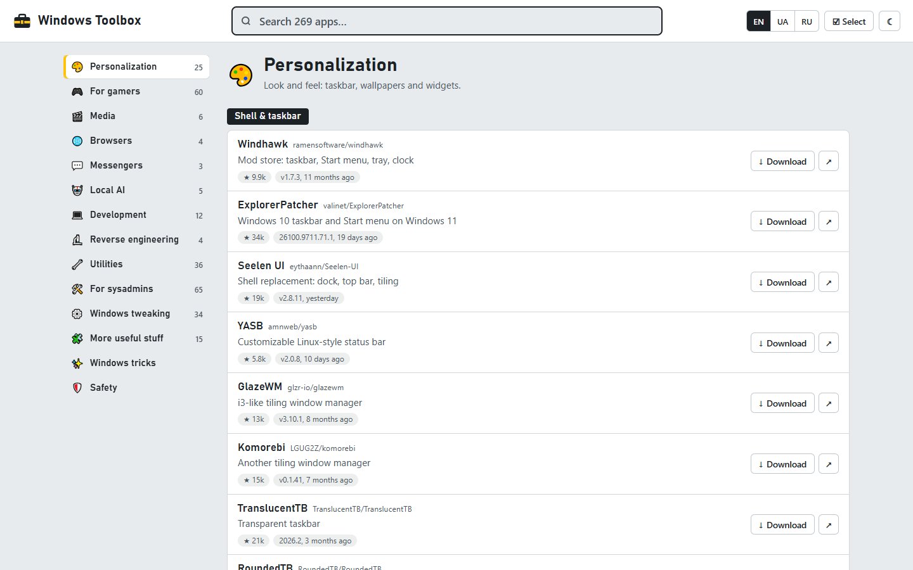
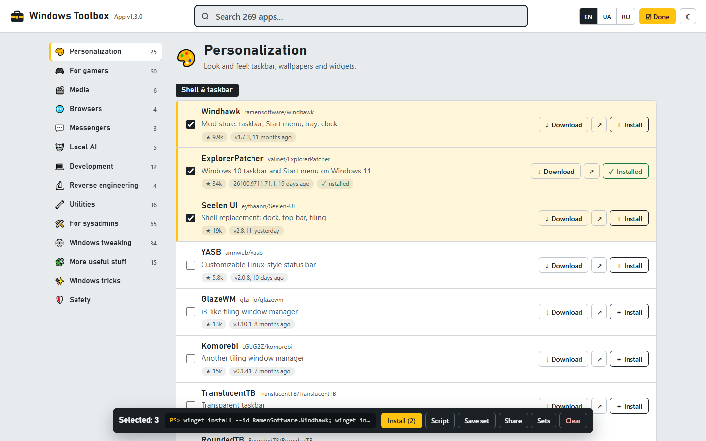
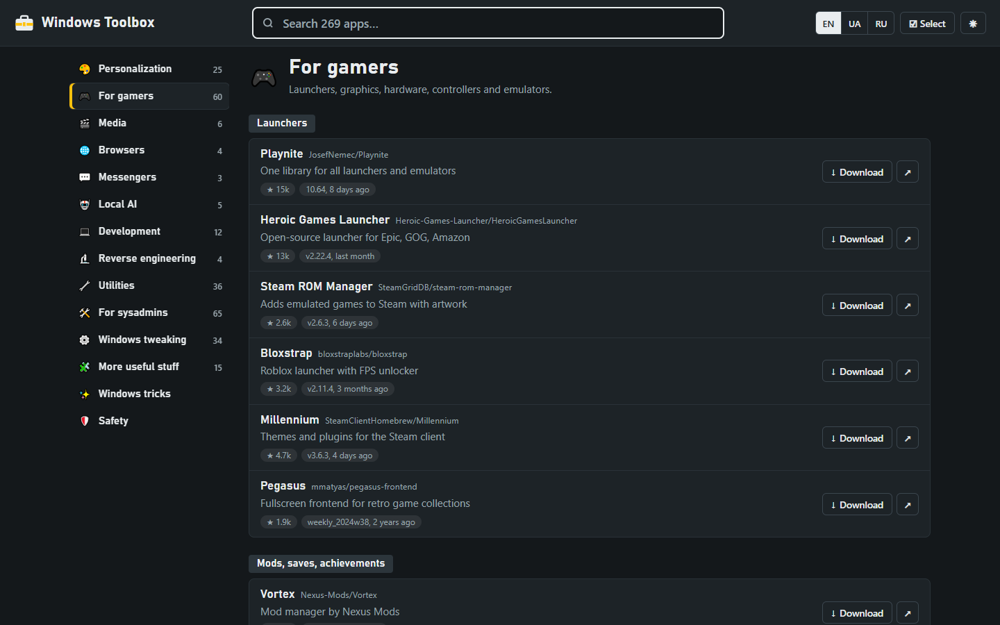

# Windows Toolbox

[English](README.md) | **Русский** | [Українська](README.uk.md)

[](https://github.com/barnibeats/windows-toolbox/releases/latest)
[](https://github.com/barnibeats/windows-toolbox/actions/workflows/pages.yml)
[](https://github.com/barnibeats/windows-toolbox/actions/workflows/ci.yml)
[](LICENSE)

Каталог бесплатных программ с открытым кодом для Windows и небольшое портативное приложение, которое скачивает или устанавливает их в один клик. Около 270 программ в 14 разделах: персонализация, игры, мультимедиа, браузеры, разработка, администрирование, тонкая настройка системы и другое. Интерфейс на английском, украинском и русском.

**[Скачать WindowsToolbox.exe](https://github.com/barnibeats/windows-toolbox/releases/latest/download/WindowsToolbox.exe)**: портативная версия, установка не нужна. Нужен WebView2 Runtime: в Windows 11 он встроен, для Windows 10 [скачайте его у Microsoft](https://go.microsoft.com/fwlink/p/?LinkId=2124703).

Удобнее в браузере? Откройте [веб-версию](https://barnibeats.github.io/windows-toolbox/). Каталог там тот же, но без установки в один клик.



## Что можно делать

- **Находить программы.** Поиск идёт сразу по всем программам, а разделы переключаются слева. Клавиша `/` переводит фокус на поиск.
- **Скачивать в один клик.** Каждая программа ведёт прямо на файл для Windows из её последнего релиза на GitHub. Ссылки, звёзды и даты релизов обновляются раз в сутки.
- **Устанавливать через winget.** В приложении программы из winget ставятся тихо, одним кликом. Установленные программы и доступные обновления помечены. Каждую установку Windows просит подтвердить.
- **Собирать наборы.** Нажмите «Выбрать», отметьте несколько программ, затем установите их разом, сохраните набор, поделитесь ссылкой или выгрузите скрипт PowerShell.
- **Всегда быть в курсе.** Каталог обновляется при каждом запуске, а приложение само ставит свои новые версии при закрытии. Без сети показывается последняя сохранённая копия.



## Что внутри

Персонализация, игры (лаунчеры, моды, графика, железо, стриминг, эмуляторы), мультимедиа, браузеры, мессенджеры, локальный ИИ, разработка, реверс-инжиниринг, утилиты, администрирование, настройка Windows, а также встроенные горячие клавиши Windows, скрытые функции и полезные команды терминала.

Есть тёмная тема и вёрстка для телефона.



## Безопасность

- Скачивайте только со страницы **Releases** этого репозитория. Подделок популярных программ много.
- Каждую установку из приложения нужно подтвердить в окне Windows, которое страница подделать не может.
- Новая версия приложения принимается, только если совпадают размер, версия и (для подписанных сборок) подпись.
- В приложении нет аккаунтов и аналитики. Собственные запросы приложения идут только к GitHub и к сайту этого репозитория на GitHub Pages (установщики winget скачивает у издателей, как обычно).
- Перед установкой проверяйте дату последнего релиза.

## Как добавить программу

Откройте задачу по форме [Suggest an app](https://github.com/barnibeats/windows-toolbox/issues/new?template=suggest-app.yml) или отредактируйте [`catalog.json`](catalog.json) и отправьте pull request. Одна программа занимает одну строку:

```json
{"n":"Windhawk","r":"ramensoftware/windhawk","w":"RamenSoftware.Windhawk","d":{"en":"Mod store: taskbar, Start menu, tray, clock","uk":"…","ru":"…"}}
```

Подробности и правила: [CONTRIBUTING.md](CONTRIBUTING.md) (на английском).

## Сборка из исходников

Нужен Node.js 22 или новее. Само приложение собирается компилятором C#, который есть в Windows (.NET Framework 4).

```powershell
npm ci
npm test                          # проверяет каталог, собирает и тестирует страницу
node tools/build.mjs              # dist/index.html, откройте его в браузере
powershell -ExecutionPolicy Bypass -File app\build.ps1    # WindowsToolbox.exe
```

| Путь | Что там |
| --- | --- |
| `catalog.json` | каталог: разделы, программы, горячие клавиши, советы, команды. Править нужно его |
| `site/index.html` | страница: оформление, интерфейс и логика. Каталог вшивается при сборке |
| `app/` | портативное приложение (`Program.cs`) и скрипт сборки |
| `tools/` | сборка, проверки ссылок и winget, тесты, скриншоты |
| `.github/workflows/` | проверки pull request, ежедневная публикация на GitHub Pages, релизы |

## Лицензия

[MIT](LICENSE). У программ из каталога свои лицензии.
