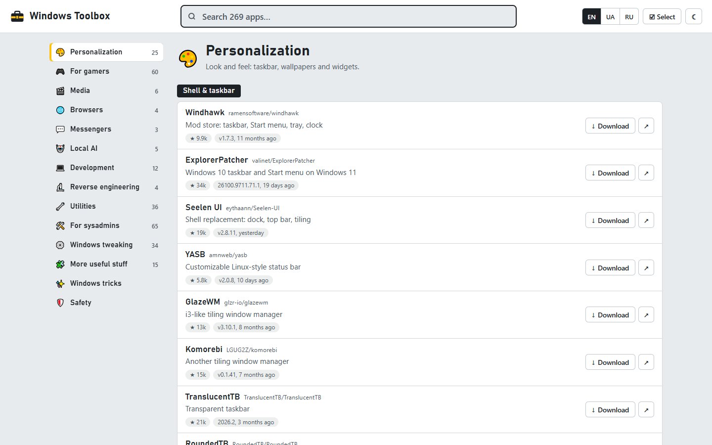
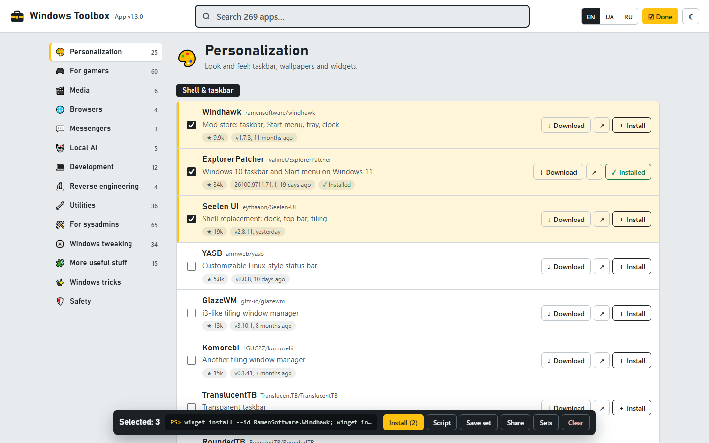
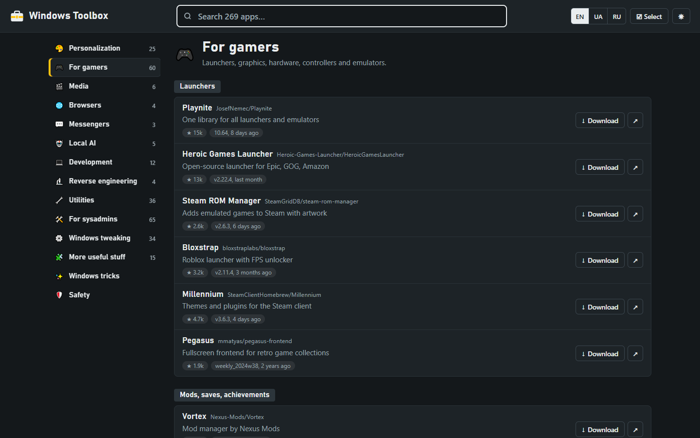

# Windows Toolbox

[English](README.md) | [Русский](README.ru.md) | **Українська**

[](https://github.com/barnibeats/windows-toolbox/releases/latest)
[](https://github.com/barnibeats/windows-toolbox/actions/workflows/pages.yml)
[](https://github.com/barnibeats/windows-toolbox/actions/workflows/ci.yml)
[](LICENSE)

Каталог безкоштовних програм з відкритим кодом для Windows і невеликий портативний застосунок, який завантажує або встановлює їх одним кліком. Близько 270 програм у 14 розділах: персоналізація, ігри, мультимедіа, браузери, розробка, адміністрування, тонке налаштування системи та інше. Інтерфейс англійською, українською та російською.

**[Завантажити WindowsToolbox.exe](https://github.com/barnibeats/windows-toolbox/releases/latest/download/WindowsToolbox.exe)**: портативна версія, встановлення не потрібне. Потрібен WebView2 Runtime: у Windows 11 він вбудований, для Windows 10 [завантажте його від Microsoft](https://go.microsoft.com/fwlink/p/?LinkId=2124703).

Зручніше в браузері? Відкрийте [веб-версію](https://barnibeats.github.io/windows-toolbox/). Каталог там той самий, але без встановлення одним кліком.



## Що можна робити

- **Знаходити програми.** Пошук іде одразу по всіх програмах, а розділи перемикаються ліворуч. Клавіша `/` переводить фокус на пошук.
- **Завантажувати одним кліком.** Більшість програм ведуть прямо на файл для Windows з останнього релізу на GitHub. Для решти кнопка відкриває сторінку завантаження. Посилання, зірки й дати релізів оновлюються щодоби.
- **Встановлювати через winget.** У застосунку програми з winget встановлюються тихо, одним кліком. Встановлені програми та доступні оновлення позначені. Застосунок просить підтвердити кожне встановлення у вікні Windows.
- **Збирати набори.** Натисніть «Вибрати», позначте кілька програм, потім встановіть їх разом, збережіть набір, поділіться посиланням або вивантажте скрипт PowerShell.
- **Завжди бути в курсі.** Каталог оновлюється під час кожного запуску, а застосунок сам встановлює свої нові версії під час закриття. Без мережі показується остання збережена копія.



## Що всередині

Персоналізація, ігри (лаунчери, моди, графіка, залізо, стрімінг, емулятори), мультимедіа, браузери, месенджери, локальний ШІ, розробка, реверс-інжиніринг, утиліти, адміністрування, налаштування Windows, а також вбудовані гарячі клавіші Windows, приховані функції та корисні команди терміналу.

Є темна тема та верстка для телефона.



## Безпека

- Завантажуйте лише зі сторінки **Releases** цього репозиторію. Підробок популярних програм багато.
- Кожне встановлення із застосунку потрібно підтвердити у вікні Windows, яке сторінка підробити не може.
- Нова версія застосунку приймається, лише якщо збігаються розмір, версія та (для підписаних збірок) підпис.
- У застосунку немає облікових записів і аналітики. Власні запити застосунку йдуть лише до GitHub і до сайту цього репозиторію на GitHub Pages (інсталятори winget завантажує в видавців, як зазвичай).
- Перед встановленням перевіряйте дату останнього релізу.

## Як додати програму

Відкрийте задачу за формою [Suggest an app](https://github.com/barnibeats/windows-toolbox/issues/new?template=suggest-app.yml) або відредагуйте [`catalog.json`](catalog.json) і надішліть pull request. Одна програма займає один рядок:

```json
{"n":"Windhawk","r":"ramensoftware/windhawk","w":"RamenSoftware.Windhawk","d":{"en":"Mod store: taskbar, Start menu, tray, clock","uk":"…","ru":"…"}}
```

Подробиці та правила: [CONTRIBUTING.md](CONTRIBUTING.md) (англійською).

## Збірка з вихідного коду

Потрібен Node.js 22 або новіший. Сам застосунок збирається компілятором C#, який є у Windows (.NET Framework 4).

```powershell
npm ci
npm test                          # перевіряє каталог, збирає й тестує сторінку
node tools/build.mjs              # dist/index.html, відкрийте його в браузері
powershell -ExecutionPolicy Bypass -File app\build.ps1    # WindowsToolbox.exe
```

| Шлях | Що там |
| --- | --- |
| `catalog.json` | каталог: розділи, програми, гарячі клавіші, поради, команди. Редагувати потрібно його |
| `site/index.html` | сторінка: оформлення, інтерфейс і логіка. Каталог вшивається під час збірки |
| `app/` | портативний застосунок (`Program.cs`) і скрипт збірки |
| `tools/` | збірка, перевірки посилань і winget, тести, скриншоти |
| `.github/workflows/` | перевірки pull request, щоденна публікація на GitHub Pages, релізи |

## Ліцензія

[MIT](LICENSE). Програми з каталогу мають власні ліцензії.
